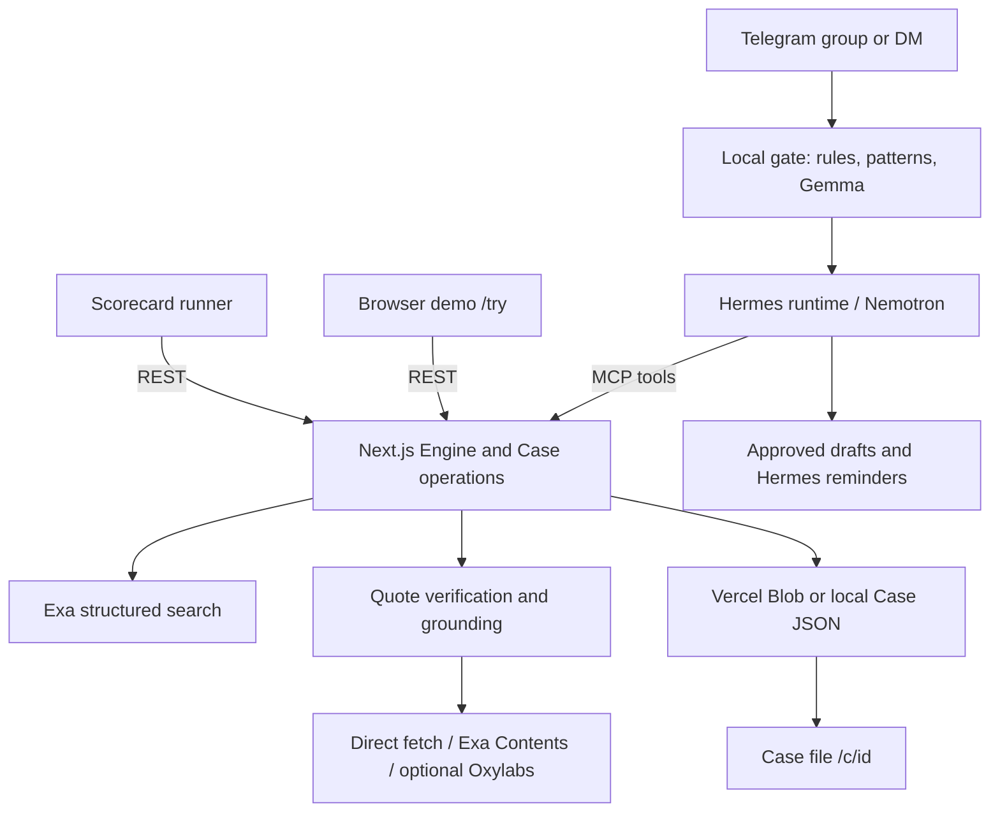

# AIDaddy

A butler in a family's Telegram group. It notices a life event or an official letter, researches the live web with Exa, and returns a short plan with checked quotes and a case file the family can inspect.

Built for international families in Finland at Junction 2026, Espoo, 13–15 November. The main challenge is **Exa — The Internet Butler / Your Personal Assistant**. [Web demo](https://86.38.238.136.sslip.io) · [Challenge brief](docs/CHALLENGE.md) · [Submission checklist](docs/SUBMISSION_CHECKLIST.md) · [MIT license](LICENSE)

## Start here

**What is still open:** [docs/NEXT.md](docs/NEXT.md) lists the team's undecided questions and suggested work in order. Read it first.

This is the **Saturday 14 November morning handover**, updated after the Hermes work merged into `main`. Source integration and deployment are separate: check the current branch, PRs and running services before relying on a dated status report.

| Workstream | State at handover |
|---|---|
| Shared Engine and web app | `main` contains research, verification, case pages, browser demo and the optional Oxylabs reader. |
| Hermes bot | [PR #6](https://github.com/zacharyb1/junction-2026/pull/6) merged into `main`: local install, Telegram flows, gate, rehearsal tooling and case-preservation repairs. Selected group/DM flows passed against a local Engine. Detailed evidence is in [Hermes handover](docs/HERMES_HANDOVER.md). |
| Container runtime | [PR #8](https://github.com/zacharyb1/junction-2026/pull/8) merged as `f7b54b6`: web/Engine, Hermes and Ollama/Gemma, with separate persistent volumes. [PR #10](https://github.com/zacharyb1/junction-2026/pull/10) adds native Linux ARM64 CI; [all checks passed on merged `main` at `dc19f65`](https://github.com/zacharyb1/junction-2026/actions/runs/43553112546), including both amd64 and ARM64 containers. Actual macOS/Docker Desktop operation remains untested. See the [container guide](docs/CONTAINERS.md) for validation limits. |
| Verifier review | [Draft PR #7](https://github.com/zacharyb1/junction-2026/pull/7): independent-reading verification and withholding unsupported money items. Separate from #6 and not merged. |
| Alternate bot | `scaffold/milestone-1-2` is the separate Hono/Mastra track; this handover does not certify it. |
| Landing design | [PR #9](https://github.com/zacharyb1/junction-2026/pull/9) merged as `d1be045`, including the artwork needed by the web container. |

PRs #6, #8, #9 and #10 are merged. Vercel blocked deployment by project access; the public health endpoint still reported `ef53df2` at 05:48 EET on 14 November. This establishes a serving revision, not working research credentials. PR #7 remains a separate draft. PR #2's original challenge plan is included in #6; #3's pnpm CI fix is already on `main`.

**Runtime snapshot, 14 November at 05:48 EET:** the completed local bot worktree was removed after its source was merged. Its leftover Engine and Ollama processes have been stopped; no gateway or scheduler from that installation was running. The five local test Cases and saved reminder are no longer available from that installation. They were private runtime data, not Git files; targeted checks found no surviving external backup. A fresh setup starts with fresh state unless a separate backup is supplied. The successful Telegram tests below remain historical evidence. Another host using the shared token is outside this check.

## Goal and core concepts

The demo should complete a few chosen scenarios reliably: notice the event, acknowledge it, return a sourced plan, open its case file, and carry out an approved follow-up such as saving a draft. A final scenario set is not recorded in this handover. Unscripted messages should produce useful sourced research, a clear limitation, or group silence. We are not trying to cover every possible family situation before submission.

| Concept | Meaning |
|---|---|
| **Trigger** | A life event, tedious task, official document, direct address, or due reminder that makes AIDaddy act. |
| **Case** | One event or task taken up for a family. |
| **Plan** | The short list posted to chat; each line carries a numbered source. |
| **Case file** | The page containing the case's timeline, money, evidence, drafts and uncertainties. |
| **Verified quote** | A sentence found when the cited page was opened again. Verification is evidence of a match, not proof that a rule applies to this family. |
| **Approval** | A family member's yes to a next step, such as drafting a letter or setting a reminder. The bot never sends, files, books or pays. |

The [glossary](GLOSSARY.md) defines the shared language. English is primary; Finnish answers and case labels are supported. This is research with sources, not legal advice.

## Architecture

The **Engine** researches and checks evidence. The **bot runtime** handles conversation, the silence rule, approvals, drafts and reminders. A runtime calls `research_case` and posts the returned plan; the browser demo and scorecard call the same Engine.



The gate filters group text before a cloud call. Authorized Telegram messages can wait in a small recent-context buffer for the same chat and topic; the next trigger carries those earlier facts into the conversation so the family need not repeat them. Direct messages, addressed messages and media take rule-based wake paths; an active topic also has a three-minute open window. This means neither all small talk nor all photos stay local. The runtime posts a start notice for research, then the bot posts its sourced result before offering next actions. See [the Telegram contract](docs/CONTRACTS.md#telegram-context-and-work-notices) and [the live demo procedure](docs/TELEGRAM_DEMO.md).

| Part / tool | Role and code |
|---|---|
| Next.js, React, TypeScript | Web app and Engine in one deployment. Routes in [`src/app/`](src/app/), research in [`src/lib/engine/`](src/lib/engine/). |
| Exa (`exa-js`) | Finds sources and returns structured research; Contents supplies a second reading. Exa remains the only finder. |
| Verifier and grounding | [`verify.ts`](src/lib/verify.ts), [`ground.ts`](src/lib/engine/ground.ts), [`text.ts`](src/lib/text.ts): match quotes, ground numbers and expose uncertainty. |
| Case module | [`case.ts`](src/lib/case.ts) defines the data, [`cases.ts`](src/lib/cases.ts) publishes/updates/rechecks, [`store.ts`](src/lib/store.ts) persists it. |
| MCP and REST | [`docs/CONTRACTS.md`](docs/CONTRACTS.md) defines auth, tools and responses shared by both bot tracks and the web demo. |
| Hermes + NVIDIA Nemotron | Repo-local pinned runtime, conversation and native letter-photo reading. Persona and product skills in [`hermes/`](hermes/). |
| Ollama + Gemma | Local group-message gate, launched with Podman or Docker. Plugin in [`hermes/plugins/kaveri-gate/`](hermes/plugins/kaveri-gate/). |
| Vercel + Blob | Web hosting and production Case storage. Without a Blob token, Cases live in `.data/cases` under the Engine's working directory. |
| Tailwind + shadcn/Base UI | Interface components; [`package.json`](package.json) and the lockfile are authoritative for versions. |
| pnpm + GitHub Actions | Reproducible install and checks in [CI](.github/workflows/ci.yml). |

The scaffold's `/api/chat` and `src/lib/ai.ts` remain in the repository but are not the AIDaddy research path; the scaffold's own chat page is removed. `/chat` is the chat with AIDaddy: it calls `/api/aidaddy`, not the scaffold's endpoint, and the chat's earlier address redirects to it (`next.config.ts`). Sponsor tools proposed for later are listed separately below.

### The site, page by page

AIDaddy is both the product and the butler, one thing with one name. It sits in a family's group chat, silent until it matters, and speaks on Telegram and on the web. Every page is drawn inside one shared frame, [`src/components/site/`](src/components/site/): the same header (Demos, Try AIDaddy without setup, Talk to AIDaddy, Set up), the same footer and the same warm colours ([DESIGN.md](DESIGN.md)). A new page should use `SiteShell` from that folder. The last column says what a visitor is really looking at.

| Page | What a visitor gets | What it is |
|---|---|---|
| `/` | The front page: what AIDaddy does, one recorded run, the scorecard, and the way to every other page. | Live page. Its figures are read from `src/data/replay.json` and `src/data/scorecard.json`. |
| `/try` | The research form: describe what happened and get a plan with sources. Open to everyone on the server (`DEMO_OPEN=1`), rate limited; elsewhere it needs the access code. | Live. |
| `/c/[id]` | The case file: steps, deadlines, quotes, drafts and the log of what AIDaddy did, with the click that approves. | Live. A case exists only in the store it was researched into. |
| `/chat` | A chat with AIDaddy by text or voice. Open like `/try`; needs the web-only Hermes instance. | Live on the server. |
| `/call` | AIDaddy makes a call for the visitor: they write the task, approve the exact proposal, and read what was agreed. The call rings a test line that is answered in a browser, or the operator's test phone. [Demo calls](docs/DEMO_CALLS.md). | Built and checked with a fake provider and the real account's agent. Off until the server sets `DEMO_CALLS_ENABLED=1`; no real voice conversation has been held yet. |
| `/setup` | Get your own AIDaddy: three connections. Add the bot to a Telegram group, let it listen (`/listen`), download the browser extension (`public/aidaddy-extension.zip`). The front page's main button leads here. | Telegram live; the other two are first versions. |
| `/listen` | The listening post: a page left open on a phone or laptop. It hears the room through the browser's speech-to-text, keeps small talk on the device, researches a life event on its own and comes back with a call (a deadline or an urgent matter) or a ping. | Live in Chrome, Edge and Safari, while the page is open and on screen. The call rings on that device; it cannot ring a phone number. |
| `/demo` | The list of replays. | Index page. |
| `/demo/chat`, `/demo/browser`, `/demo/talk`, `/demo/calendar`, `/demo/call` | Scripted replays built from real case files (the phone call is a script with no case). Add `?loop=1` to repeat one without the site's header and footer on the screen at the table, or `?bare=1` to play it once that way for a recording. | Scripted replays. The browser, calendar and phone-call scenes show concepts. |
| `/autopilot` | A fixed script of specialist agents with one live check through the Engine. | Scripted demo. |
| `/scorecard` | Every scenario of the latest scorecard run, with its result and its case file, and how a quote is checked. | Live page; the rows link to case files on the production server. |

## Main decisions and why

These summarize the [append-only decision log](docs/DECISIONS.md); its dated entries retain the original reasoning and any pending team confirmation.

| Decision | Reason / consequence |
|---|---|
| Research lives in the web app, behind one shared contract. | Parallel searches, one implementation for Telegram and `/try`, and independent work on two bot runtimes. Search output still varies between runs. |
| Exa is the finder and structured research provider. | It is central to the main challenge; a separate chat-model research pipeline would duplicate work. |
| Plans need fetched-page evidence. | Quotes use the page's words; numbers must be supported on the cited page. Failed claims are withheld or exposed as unconfirmed. PR #7 tightens the remaining verifier and money-item gaps. |
| Rules and benefits start with official sources for the family's jurisdiction. | Avoid advice for the wrong country. Open-web choices use the Engine's separate scope. Country/language expansion is a team decision. |
| Conversation and approved follow-ups stay in the bot runtime. | Runtime replacement should not change the Engine or turn the web app into a Telegram bot. |
| Hermes is pinned and installed inside the checkout. | Teammates can reproduce and remove it. One process may poll the shared bot token at a time. |
| Gate order is rules, wake patterns, then local Gemma. | Patterns and the model caught different triggers in the labelled set. An uncertain model wakes the bot; an unavailable gate falls back to patterns. Media bypass and shared-profile memory remain limits for the team to assess. |
| Preserve local Cases before changing Engine directories. | An earlier directory switch broke case and reminder links. Startup/shutdown now snapshot and migrate data; backup conflicts require inspection. |

## Challenges we are pursuing

**Exa is the main submission.** Nemotron and Gemma have demonstrated roles on the Hermes track. Oxylabs has reader code but still needs a real API run; ElevenLabs has generated video voiceover, while bot voice is deferred. Gemini currently has no demonstrated Hermes job because Nemotron read the letter photo. Context.dev readers/monitors and an Aiven citation index are proposals, not working components.

The [tech-challenge status](docs/TECH_CHALLENGES.md) is authoritative for each role, evidence, remaining work and submission conditions. Platform selections have not been rechecked in this handover. Only claim technology that the final demo actually uses; the second Context.dev submission and Hostinger idea remain conditional.

## What the evidence establishes

- **Engine:** the committed [Run 6 result](eval/results/2026-11-13T22-23-23-270Z.json) records 19/19 scored cases and 133/133 matched quotes. The later [PR #7 comparison](https://github.com/zacharyb1/junction-2026/blob/b35abc9/docs/research/VERIFIER_COMPARISON.md) passed 18/19 in both runs, with 128/128 and 133/133 quotes; the lost-passport case lacked a deadline/amount. Across 261 paired quote observations, none required joined readings. Oxylabs was not exercised. These are dated samples, not a guarantee of correctness or completeness.
- **Telegram:** selected group research, letter-photo reading, silence, and a fresh DM plan with an approved saved draft worked against the local Engine. Full bot replies took longer than Engine-only timings. Some acknowledgements missed the five-second target.
- **Gate:** the 60-message development set had 0/20 missed triggers and 4/40 false wakes. In the small live sample, 6/7 small-talk messages stopped locally. A live Gemma-only trigger outside the open window remains unmeasured.
- **Recovery and reminders:** missing-case refusal, fresh research after a stale link, working case pages, and reminder creation/deduplication passed local CLI rehearsals. Reminder delivery and catch-up were not tested. No daily watch is enabled.

See [Hermes handover](docs/HERMES_HANDOVER.md) for timings, field-reading limitations, repairs and evidence files. The [scorecard harness](eval/README.md) has 21 scenarios: 19 scored Engine cases and two manual silence checks. CLI rehearsal, Engine scoring and Telegram delivery are different checks.

## Run the web app

On a Mac, the [Docker setup](docs/CONTAINERS.md) can run the whole project without installing Node, Python, pnpm or Hermes on the host. Its default command starts the web app and Engine; the explicit `bot` profile adds Hermes and the local Gemma gate. The native web setup below provides live reload while editing code; container source changes require a rebuild.

Use Node 22+ and the pnpm version in `package.json`. From the repository root:

```bash
pnpm install --frozen-lockfile
cp .env.example .env.local  # first setup only; fill in the values locally
pnpm dev                  # http://localhost:3000
```

Set `EXA_API_KEY`, `CASEFILE_SECRET` and `DEMO_ACCESS_CODE` in `.env.local`; open `/try?code=<your demo code>`. With `DEMO_OPEN=1` the demo needs no code and `/try` works as it is; the rate limit then protects the Exa credit. Leave `BLOB_READ_WRITE_TOKEN` empty for isolated local data. Keep an existing `.env.local` rather than replacing it. The [.env.example](.env.example) and [contract](docs/CONTRACTS.md) explain the remaining settings.

The team's secrets live in the separate private `kapuchai/junction-2026-keys` repository, in `app.env` and `bot.env`. Get access through the team. Never paste values into chat or commit them here.

## Deployment and Telegram operation

The web app/Engine, Hermes and the local model are separate processes. [Docker Compose](docs/CONTAINERS.md) can run all of them on one Mac or Linux server, with persistent storage for Cases, bot state and models. The default web startup starts no Telegram bot; `--profile bot` starts the whole stack. Vercel plus a separate bot host and the native installation remain options. Orca and Claude Code are development tools; neither is needed to keep the product running.

[Deployment and runtime state](docs/DEPLOYMENT.md) describes the existing Vercel connection, required environment variables and Blob storage, plus the two supported operational choices for Telegram:

- **Independent development:** use `/try` with no Hermes process, or a fresh Hermes home with a separate BotFather token and test group.
- **The shared bot:** one active gateway for its token. A transfer requires the previous gateway/scheduler to be stopped and its private state handled before the replacement starts.

The current scripts and containers have **no cross-machine lock**. Separate branches, laptops or Compose/Hermes profiles do not make a shared token safe to run twice. The shared secrets helper can replace a local test token; copying a live home also copies reminder state. The [container guide](docs/CONTAINERS.md) explains the two env files, explicit bot startup and persistent volumes. The deployment guide records shared-token transfer requirements.

The tested bot configuration uses localhost Case links, which do not open on teammates' phones. Production bot integration has not been verified. Changing the Engine URL does not move existing Cases, memories or reminders.

## Validate a change

The required branch checks are in [CI](.github/workflows/ci.yml):

```bash
node --test hermes/preserve-cases.test.mjs
python3 -m unittest discover -s eval/bot -p 'test_*.py'
python3 -m unittest discover -s eval/gate -p 'test_*.py'
python3 -m unittest discover -s hermes -p 'test_*.py'
pnpm lint
pnpm typecheck
pnpm build
```

Use an isolated checkout/copy for builds while the shared demo Engine is running; builds and type generation write `.next`. Live scorecards incur API usage and write result files: follow [eval/README.md](eval/README.md), explicitly use `--concurrency 2`, and use `--no-scorecard` for experiments that should not replace the published scorecard. Bot rehearsals are described in the runbook and do not prove Telegram delivery.

## Claude Code and existing workflows

[CLAUDE.md](CLAUDE.md) contains project context, invariants and document pointers for Claude Code. It does not require Orca, a particular agent setup, or this machine's global skills, plugins or MCP servers. The repository's `.claude/commands/` and coding skills are optional helpers; teammates can keep their own workflows and tools.

The `hermes/skills/butler/` files are different: they are product instructions loaded by the running bot. They are not instructions to install skills into a teammate's Claude Code environment.

This handover records implemented behavior, tests, limitations and earlier decisions. Historical plans remain available for context; they are not a task allocation or a current roadmap.

| Document | Read it when… |
|---|---|
| [GLOSSARY.md](GLOSSARY.md) | Naming concepts or describing product behavior. |
| [docs/DECISIONS.md](docs/DECISIONS.md) | Understanding why a choice was made or proposing to change it. |
| [docs/CONTRACTS.md](docs/CONTRACTS.md) | Changing the Engine, Case schema, transport or bot integration. |
| [docs/HERMES_HANDOVER.md](docs/HERMES_HANDOVER.md) | Reading bot evidence, repairs and limitations. |
| [docs/DEPLOYMENT.md](docs/DEPLOYMENT.md) | Deploying the app, setting up an independent bot or transferring the shared runtime. |
| [docs/CONTAINERS.md](docs/CONTAINERS.md) | Running the whole project or only the website in Docker, retaining state and controlling bot startup. |
| [hermes/README.md](hermes/README.md), [CHECKS.md](hermes/CHECKS.md) | Installing/operating Hermes or checking a configuration assumption. |
| [docs/TECH_CHALLENGES.md](docs/TECH_CHALLENGES.md) | Choosing sponsor work or preparing its submission note. |
| [docs/PLAN.md](docs/PLAN.md) | Reading the historical product design and proposed demo; its milestones are not current assignments. |
| [eval/README.md](eval/README.md), [eval/results/](eval/results/) | Running or interpreting measurements. |
| [docs/PITCH.md](docs/PITCH.md), [docs/pitch/](docs/pitch/) | Preparing the story, script and voiceover; refresh dated claims before recording. |
| [docs/CHALLENGES_TO_SELECT.md](docs/CHALLENGES_TO_SELECT.md), [docs/VERDA.md](docs/VERDA.md) | Filling in the submission form: which challenges to select, the note to paste for each, and the process summary the Verda challenge asks for. |
| [docs/DEMO_PLAN.md](docs/DEMO_PLAN.md), [docs/BOT_PLAN.md](docs/BOT_PLAN.md) | Proposals of Saturday 09:05: the run of show on the new front page, and the order of bot work before the freeze. |
| [docs/FRONT_PAGE_PLAN.md](docs/FRONT_PAGE_PLAN.md) | The front page on `/` (planned in its earlier dark look; the sections are the same): what each section shows and which data file it reads. |
| [docs/RESEARCH.md](docs/RESEARCH.md), [docs/research/](docs/research/) | Finding prior research and historical plans. |
| [docs/PLAYBOOK.md](docs/PLAYBOOK.md) | Checking event rules and logistics before submission. |
| [docs/STARTERS.md](docs/STARTERS.md) | Consulting the pre-product template catalogue; it is not the current architecture. |
