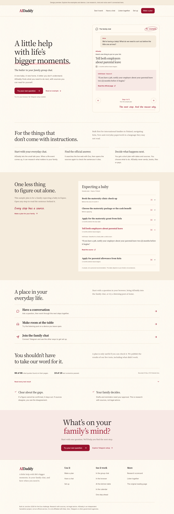
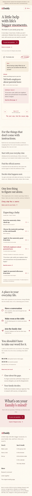
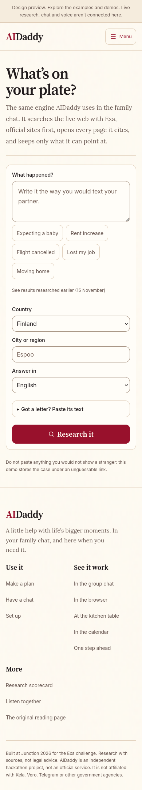

# Impeccable site review

Vlad chose the Impeccable homepage comparison and requested the same design throughout the site, with more expressive motion and interaction, then team review. The approved direction is the family reading table: ivory paper, cranberry annotations, Chiron Sung HK display type, Lora prose, Inter controls and Kalam notes. The original `/reading` page remains available.

## What to try

1. On the homepage, replay the ink, move between the five sample steps and compare each with its source. Expand the sample plan and the full scorecard.
2. In **Make a plan**, choose an example, change country, paste a letter and inspect the failure fallback when live research is unavailable. Previously recorded cases are still readable.
3. In **Have a chat**, select a conversation starter and edit it. An unsuccessful send preserves the draft.
4. Open a recorded case and follow a source number. It brings its evidence into view and highlights the source.
5. Visit setup and read what each connection actually does. The controls open real integration entry points.
6. Open a replay, pause to read it, resume, and restart. Try the same controls on a phone and with reduced motion enabled.

## Validation

- Production build, TypeScript and ESLint pass. The Next font build reports missing fallback override values for Chiron Sung HK; its downloaded font loads and renders correctly in browser captures.
- 269 Vitest tests, 40 Node tests and 112 Python tests pass. Two Python checks skip because their pinned container environment is unavailable locally. Container builds were not rerun for this frontend change.
- Fifteen routes checked at 1440 × 960 and 390 × 960: `/`, `/try`, `/chat`, a recorded case, `/setup`, `/listen`, `/autopilot`, `/demo`, all four replay routes, a missing route `/reading` and `/scorecard`. No horizontal overflow or runtime errors.
- Homepage additionally checked at 768px and 320px. Keyboard navigation, access-code routing, no-JavaScript content, reduced motion, repeated replay, disclosure states, form error recovery and chat draft preservation checked.
- All 19 scorecard cases resolve inside the preview. A fresh local store contains only 25 synthetic records already committed in the evaluation/demo inputs.
- Asset provenance scan: 19 shipped rasters, none missing origin metadata. Icons are rasterized from the existing Lucide bell vector; paper and ink retain their earlier provenance.

## Preview boundaries

`UI_PREVIEW=1` adds a review-only banner. The temporary HTTPS preview has no Exa, voice, bot or storage-provider credentials. It supports browsing recorded cases and scripted demos; live research, agent conversations and voice are unavailable there. No production deployment or Telegram gateway was changed.

PR #89 merged while this work was under review. Its latest setup, extension, listening, case and scorecard changes are incorporated here; the selected Impeccable visual system is applied over them. Browser calling in PR #105 is separate from this design work and does not establish native Telegram live calling.

## Screenshots

Production screenshots show the review banner. Motion is settled and reduced motion is enabled for repeatable captures.

